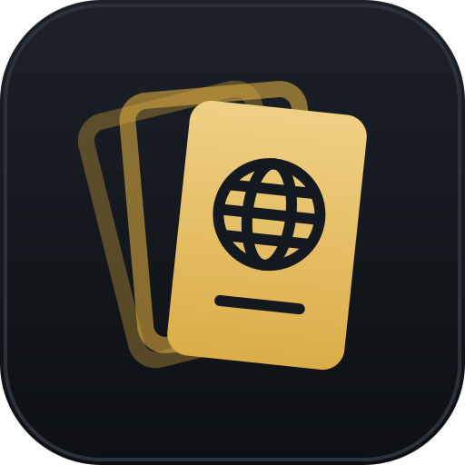
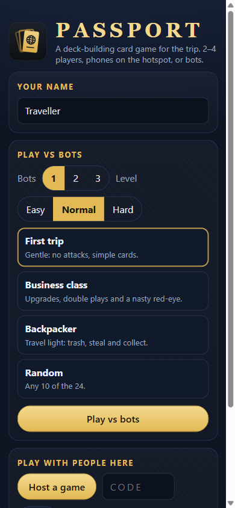
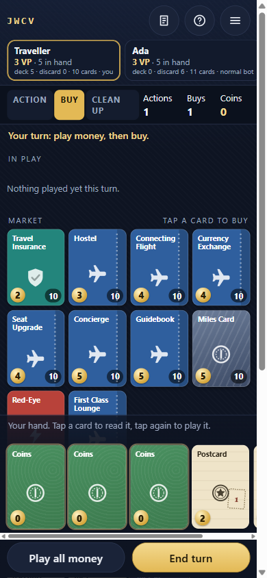

<p align="center"></p>

# Passport: a deck-building card game for the trip

An [AirplaneMode](https://github.com/jessewolcott/airplanemode) app. Passport is a deck-builder
for 2 to 4 players: everyone on the router's hotspot plays from their own phone, with bots
filling empty seats (or a whole table of bots, to play alone). No internet, no accounts.

<p align="center">
  
  
</p>

<sub>Screenshots from a laptop browser at phone size. Not yet tested on real hardware or real phones. Played through in a desktop browser (phone-sized window) against bots; people-vs-people is covered by the API tests.</sub>

## How to play

- Everyone starts with the same 10 cards: 7 **Coins** and 3 **Postcards**. Each turn you hold 5.
- **Action:** play one action card. Some give more actions, cards, buys or coins.
- **Buy:** play your money and buy one card from the market. It goes on your discard pile.
- **Clean up:** discard everything you played and held, draw 5 new cards. When your deck runs
  out, your discard pile is shuffled into a new one, so what you bought starts to show up.
- **Points:** Postcard 1 VP, Passport Stamp 3, Visa 6. They do nothing in your hand, so buy
  money and actions first, points later. Attacks hand out **Jet Lag** (-1 VP).
- **The end:** when the Visas run out or any three piles are empty, at the end of that turn.
  Most VP wins; a tie goes to whoever took fewer turns, otherwise it's shared. (A safety net
  ends a stalled game after 60 rounds.)

Each game uses 10 of the 24 kingdom cards: a named set chosen in the lobby (**First trip**:
gentle, no attacks; **Business class**; **Backpacker**) or 10 at random. The page has a
"How to play" overlay, and every card can be tapped to read it.

Pile sizes: 8 of each victory card with 2 players, 12 with 3-4; Jet Lag 10 per opponent;
10 of each kingdom card; Coins 60 minus the starting ones, Banknotes 40, Gold Cards 30.

## The cards

Money: **Coins** (cost 0, +1), **Banknotes** (3, +2), **Gold Card** (6, +3).

| Card | Cost | Type | Text |
|---|---|---|---|
| Window Seat | 2 | action | +1 card, +1 action. Look at the top card of your deck: you may discard it. |
| Packing Cubes | 2 | action | +1 action. Discard up to 2 cards: +1 coin for each. |
| Customs | 2 | action | Trash up to 3 cards from your hand. |
| Travel Insurance | 2 | action, reaction | +1 card, +1 action. When another player plays an attack, you may show this from your hand to be unaffected by it. |
| Hostel | 3 | action | +1 card, +2 actions. |
| Duty Free | 3 | action | +1 buy, +2 coins. |
| Souvenir Shop | 3 | action | Gain a card costing up to 4. |
| Hitchhike | 3 | action | +2 actions. Turn over the top card of your deck: an action or currency goes into your hand, anything else is discarded. |
| Light Packer | 3 | action | +1 card, +1 action. You may trash a card from your hand. |
| Overbooked | 4 | action, attack | +2 coins. Every other player discards down to 4 cards in hand. |
| Delayed Flight | 4 | action, attack | +2 cards. Every other player with 4 or more cards in hand puts one of them on top of their deck. |
| Connecting Flight | 4 | action | You may play an action card from your hand twice. |
| Currency Exchange | 4 | action | +1 buy. Trash up to 2 Coins from your hand: +2 coins for each. |
| Seat Upgrade | 4 | action | Trash a card from your hand. Gain a card costing up to 3 more than it. |
| Street Food | 4 | action | +1 card, +1 action, +1 coin. |
| Backpack | 4 | action | Draw until you have 6 cards in hand. |
| Scrapbook | 4 | victory | 1 VP for every 4 differently named cards you own (round down). |
| Guidebook | 5 | action | Choose two different: +2 cards; +2 actions; +2 coins; +1 buy. |
| Concierge | 5 | action | +2 cards, +1 action. You may discard a card for +1 coin. |
| Red-Eye | 5 | action, attack | +1 card, +1 coin. Every other player gains a Jet Lag. |
| Lost Luggage | 5 | action, attack | +2 coins. Every other player turns over the top 2 cards of their deck, trashes the priciest currency among them other than Coins, and discards the rest. |
| Group Tour | 5 | action | +3 cards, +1 buy. Every other player draws a card. |
| Miles Card | 5 | currency | +2 coins, +1 buy. |
| First Class Lounge | 6 | action | +3 cards, +1 action. |

## Playing together

- **Play vs bots:** one tap, 1-3 bots (easy, normal or hard) and a card set.
- **Host a game:** you get a 4-letter code. Others open Passport and join it, or pick it from
  "Games on this hotspot". The host adds bots, picks the card set and starts.
- Your seat is kept in your browser: a refresh or a locked phone puts you back in it. If you
  leave, or stop responding for a minute while the game waits on you, a bot plays your seat
  until you come back. If everyone is away, the game pauses.
- **Rematch** after a game keeps the room and the players.

Bots: **easy** buys money (and now and then something random), **normal** plays "big money"
with one or two good actions and buys points as the end nears, **hard** reads the kingdom
(a money plan around the best attack or drawer, or a small engine; a trasher early; Travel
Insurance against attacks) and won't end the game while it's losing.

## Running it

**On the box:** the platform repo runs the released image at `/passport/`.

**On its own, for development:**

```
docker compose up -d --build        # http://localhost:8772
python tests/test_passport.py       # rules, bots, rooms and API (CI runs these before building)
```

Python 3.10+ with `fastapi`, `uvicorn` and `httpx` to run the tests locally
(`py -3.10 -m venv .venv`, then `.venv\Scripts\pip install -r requirements.txt httpx==0.28.1`).

## Settings

Everything lives in memory (rooms, games), so there's no volume. Memory limit 64 MB.

| Variable | Default | Meaning |
|---|---|---|
| `PASSPORT_BOT_DELAY` | `0.7-1.2` | seconds a bot waits before each move (`0` in tests) |
| `PASSPORT_TAKEOVER` | `60` | seconds without hearing from a player before a bot covers their seat |
| `PASSPORT_ROOM_TTL` | `7200` | seconds before an idle room is forgotten (at most 200 rooms) |
| `PASSPORT_POLL` | `20` | how long a state request waits for something to change |
